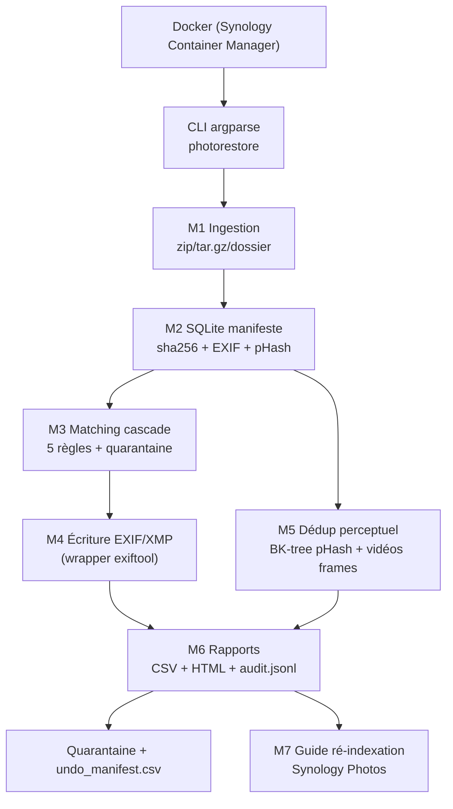

# Cahier des charges — PhotoRestore
## L'outil personnel de restauration de métadonnées et de dédoublonnage photo (Google Takeout → Synology Photos)

> **Mode d'emploi — édition finale (15 novembre 2026)** : ce document est la référence de développement exécutée par **Mistral Large 4 « Le Chonk »** (sorti le 6 octobre 2026, poids ouverts, n°1 FrontierCode des modèles ouverts) dans le projet Mistral Studio **PhotoRestore**, dépôt lié `Alexandre-EMR/photorestore` (branche `main`, privé). **P1 est livré** : squelette complet, manifeste SQLite resumable, règle R1, CLI dry-run, 10 tests unittest verts, 3 commits sur `main`. **AGENTS.md à la racine du dépôt est la règle absolue** — en cas de conflit, il prévaut sur ce document. La section 10 contient les prompts prêts à coller, dans l'ordre : 10.3 (R2–R5) → 10.4 (exif_write) → 10.5 (dedup) → 10.6 (rapports & Synology). Les prompts obsolètes (squelette, manifeste, R1) sont marqués ✅ — ne pas les rejouer.

---

## 1. Contexte & vision

**Histoire** : photos agrégées au fil du temps depuis plusieurs appareils et disques durs (nommages et formats hétérogènes), centralisées sur Google Photos, puis exportées via Google Takeout (plusieurs ZIP) et importées dans **Synology Photos** sur un NAS. Les métadonnées (date de prise de vue, GPS, descriptions, albums) ont été livrées **séparément** dans des fichiers JSON « sidecars ». La bibliothèque NAS contient en outre des **doublons** : fichiers identiques sous des noms différents, et fichiers de même nom au contenu différent.

**Vision** : un outil CLI Python open source, **local-first** (aucune donnée ne quitte la machine), qui réassocie les métadonnées aux médias avec une fiabilité vérifiable, dédoublonne par comparaison de **contenu pixel** (pas seulement par nom), journalise chaque décision, et prépare la ré-indexation Synology Photos.

**Nom de code** : `photorestore`. Repo GitHub personnel, Apache-2.0 (pour pouvoir le publier ensuite).

## 2. Objectifs mesurables & critères de succès

| # | Objectif | Critère de succès mesurable |
|---|---|---|
| O1 | Réassocier les JSON Takeout aux médias | ≥ 95 % de matchs sûrs sur le corpus réel ; 100 % des décisions journalisées |
| O2 | Ne JAMAIS écrire une métadonnée sur la mauvaise photo | 0 faux positif non détecté : toute ambiguïté → quarantaine (jamais d'écriture) |
| O3 | Dédoublonner par pixels | détection des doublons binaires exacts (sha256) ET des quasi-doublons (pHash distance ≤ 5) ET des cas « même nom, contenu différent » |
| O4 | Être sûr | dry-run par défaut, idempotent (relancer 2× ne change rien), aucune suppression (quarantaine uniquement), manifeste undo |
| O5 | Être rejouable | corpus de test synthétique + `make replay` qui rejoue tout depuis zéro, tests unittest verts |
| O6 | Tourner partout | Windows (où sont les ZIP), Linux, et Docker sur Synology (Container Manager) |

## 3. Périmètre

**Dans le périmètre** : photos et vidéos des exports Google Takeout ; fusion de multiples archives ; réécriture EXIF/XMP ; dédoublonnage perceptuel ; rapports d'audit ; guide de ré-indexation Synology Photos.

**Hors périmètre (v1)** : interface graphique (prévue v2, optionnelle) ; reconnaissance de visages ; upload vers un cloud ; modification des ZIP Takeout d'origine (intouchables) ; matching par IA générative (le matching nominal est déterministe — l'IA n'intervient qu'en audit, hors outil).

## 4. Exigences fonctionnelles — modules

### M1 — Ingestion
- Accepte un dossier contenant des **archives brutes** (`.zip`, `.tar.gz`, multiples parties) et/ou un dossier déjà extrait, sans exiger de décompression manuelle préalable (cf. takeout-fixer).
- Fusionne logiquement toutes les archives dans **une vue unique** (un média et son JSON peuvent être dans des archives différentes).
- Ne modifie JAMAIS les archives sources ; travail sur copies ou in-place selon `--strategy copy|in-place`.
- Détecte la localisation du dossier photos (`Google Photos`, `Google Fotos`, etc. — paramétrable `--photo-dir`).

### M2 — Inventaire & manifeste (SQLite) ✅ livré (P1)
- Base SQLite (WAL) unique : chaque média → chemin, sha256, taille, date EXIF existante (DateTimeOriginal, CreateDate), date fichier, hash perceptuel, statut de matching.
- Chaque JSON → chemin, `photoTakenTime.timestamp`, `geoData`, `title`, `description`, `album` (via `metadata.json` d'album).
- **Resumable** : une exécution interrompue reprend où elle s'était arrêtée (états par fichier : `discovered → hashed → matched → applied → verified`).

### M3 — Cascade de matching (le cœur anti-erreur) — R1 ✅ livrée (P1), R2–R5 à implémenter (P2)
Règles en cascade, de la plus certaine à la moins certaine. **Toute ambiguïté = quarantaine, jamais d'écriture.**
1. `exact` : `media.ext` ↔ `media.ext.supplemental-metadata.json` ou `media.ext.json` (ancien format).
2. `trunc` : sidecar tronqué à **46 caractères** — match si un seul média du dossier commence par ces 46 caractères.
3. `title` : le champ `title` du JSON contient le nom original du média.
4. `heuristique` : taille ± 2 % + date de prise de vue proche (± 48 h) + même album/dossier — match uniquement si **tous** les critères tiennent.
5. `perceptuel` : pHash distance ≤ 3 entre le média sans JSON et un média porteur de JSON — **proposition en quarantaine pour revue humaine**, jamais d'écriture automatique.
- Gère explicitement : doublons `(1)` (sidecar `supplemental-metadata(1).json` → média `(1)`), copies `-edited`, vidéos, Live Photos iOS (paire photo+vidéo `.HEIC`+`.MOV`).

### M4 — Écriture EXIF/XMP (non destructive par défaut)
- Trois politiques d'écriture configurables : `fill-missing` (défaut — ne remplit que les champs absents, cf. mattwilson1024) / `json-wins` (le JSON écrase, cf. gophix) / `ask`.
- Champs écrits : `DateTimeOriginal` (+ fuseau : le timestamp JSON est en **epoch UTC** — écrire l'heure exacte avec offset, ne pas deviner de fuseau local), `GPSLatitude/Longitude` (+ Ref automatique), description → XMP-dc, date fichier synchronisée.
- Correction d'**extensions mensongères** (PNG nommé `.jpg` — cf. gophix), avec renommage journalisé.
- Si le format n'accepte pas l'EXIF → **sidecar XMP** (`.xmp`), sans échec.
- Vérification post-écriture : relire l'EXIF et comparer à la valeur attendue ; statut `verified` ou échec bloquant.

### M5 — Dédoublonnage perceptuel (par pixels, pas par nom)
Quatre familles de cas, toutes détectées :
- **L0 — Octets identiques, noms différents** : sha256 identique → groupe « doublon exact ».
- **L1 — Quasi-identiques (réencodés, redimensionnés, recompressés)** : pHash (DCT, `hash_size=8` puis confirmation `hash_size=16`) avec **distance de Hamming ≤ 5 = quasi-certain même image** ; au-delà de 5, les faux positifs augmentent — les paires 6–10 sont marquées `variant` (recadrage, filtre) pour revue, jamais fusionnées automatiquement.
- **L2 — Même nom, contenu différent** : sha256 différents pour un même nom de base → les deux fichiers sont conservés, le plus ancien/qualitatif garde le nom, l'autre est suffixé `.CONFLICT-<sha8>` et mis en quarantaine.
- **L3 — Vidéos** : sha256, puis échantillonnage de frames (ffmpeg, 1 frame/10 s, max 30) + pHash par frame ; doublon si **≥ 3 frames** à distance ≤ 8 (inspiré des pratiques documentées de video dedup).
- Index de recherche : **BK-tree** (ou équivalent) pour rester O(n log n) sur 100 000+ images (cf. bibliothèque perception).
- **Politique de conservation** : priorité configurable — original > `-edited` > `(1)` > recompressé ; le perdant est **déplacé** vers `<racine>/_duplicates/` (jamais supprimé), avec manifeste `undo_manifest.csv` (chemin d'origine → destination) permettant une annulation d'un coup.

### M6 — Rapports & audit
- `match_report.csv` : chaque décision (fichier, règle utilisée, ancienne valeur, nouvelle valeur, statut).
- `quarantine/` : médias et JSON non résolus + `quarantine_report.csv` motivé.
- `summary.html` : tableau de bord (taux de match par règle, par album, par année ; anomalies : GPS (0,0), dates hors bornes 1900–2026, échecs par dossier).
- `audit_export.jsonl` : export textuel anonymisable (noms de fichiers + stats) destiné à un **agent d'audit Mistral Studio** — jamais les pixels.

### M7 — Intégration Synology
- Mode `in-place` : pointage direct du dossier photo du NAS (monté SMB/NFS ou exécution Docker locale au NAS via **Container Manager**), avec avertissement + confirmation avant écriture sur le NAS.
- À la fin : impression du guide de **ré-indexation** (Synology Photos → icône Compte → Paramètres → Indexation → Ré-indexer) avec rappel que sans cette étape, les dates affichées ne bougent pas.
- Image Docker officielle du projet (multi-arch amd64/arm64 pour les NAS Synology ARM et Intel).

### M8 — CLI & configuration ✅ base livrée (P1)
- CLI **argparse** (livrée P1, cohérente avec la politique zéro-dépendance — pas de typer) : sous-commandes dry-run, `--dry-run` **par défaut**, `--apply` explicite avec confirmation interactive ; les commandes non implémentées (`fix`, `dedup`) refusent proprement (code retour 2) tant que P2/P3 ne sont pas livrés.
- Config TOML (`config.toml`, livrée) : seuils de Hamming, politique de conservation, politique d'écriture, chemins.
- `photorestore undo` : restaure les déplacements de doublons depuis `undo_manifest.csv` (actif à partir de P3).

## 5. Matrice de reprise des outils existants

| Fonctionnalité reprise | Source d'inspiration | Module |
|---|---|---|
| Lire les archives brutes sans extraction manuelle, gérer l'éclatement multi-zip | GoogleTakeoutPhotoFixer (Rust) | M1 |
| Priorité JSON > EXIF, extensions mensongères, sidecar XMP de repli | gophix (Go) | M4 |
| Ne remplir que les champs manquants (non destructif) | google-photos-exif (mattwilson1024) | M4 |
| Live Photos iOS, `--dry-run`, orientation import Synology | scripts alexmonnerie (Python) | M1, M4 |
| Albums (`metadata.json`), résumé album, liste des médias sans JSON | takeout-fixer, immich-go | M2, M6 |
| Sidecars tronqués 46 car., doublons `(1)`, ancien format `.json` | guides TakeoutJson testés | M3 |
| pHash + BK-tree, seuils de Hamming, similar images multi-formats | czkawka, perception, imagededup | M5 |
| Rapport final vérifiable avant suppression de quoi que ce soit | immich-go | M6 |

## 6. Exigences non fonctionnelles

1. **Sûreté d'abord** : dry-run par défaut ; idempotence testée (2 runs successifs → zéro diff) ; aucune suppression ; manifeste undo ; checksums avant/après.
2. **Local-first** : zéro appel réseau dans le cœur de l'outil ; les pixels ne quittent jamais la machine.
3. **Performance** : 100 000 photos en moins de 4 h sur un laptop 8 cœurs (hash + EXIF parallélisés, `concurrent.futures`) ; SQLite en WAL ; reprise après interruption.
4. **Portabilité** : Python 3.12+, `pip install photorestore` ; binaire `exiftool` en dépendance externe documentée (wrapper, pas de réimplémentation de l'EXIF).
5. **Qualité** : tests **unittest** (framework en place depuis P1 — pas de pytest) avec **corpus de test synthétique** généré par script (images factices + sidecas JSON couvrant chaque cas limite) ; coverage des règles de matching ≥ 90 % ; `make replay` rejoue la démo complète depuis zéro.
6. **Observabilité** : logs structurés horodatés, un CSV par étape, code retour non nul en cas d'échec d'étape.

## 7. Architecture technique recommandée



**Stack (état réel)** : le cœur P1 est livré en **bibliothèque standard pure** — `argparse` (CLI), `sqlite3` (manifeste, WAL), `unittest` (tests), Makefile (`test`, `replay`). Cette politique zéro-dépendance reste la règle ; exceptions **documentées** au fil des phases : `exiftool` en subprocess (M4), `Pillow`+`ImageHash` pour le pHash (R5/M5 — premières dépendances du projet), `ffmpeg` pour les frames vidéo (L3). Ruff optionnel. Un seul process, zéro service — la complexité doit rester proportionnelle à la tâche.

**Où l'exécuter** : (a) développement et tests dans la **sandbox Mistral Studio** (conteneur Linux + Python fourni, cf. docs Studio) ; (b) run réel sur le PC Windows où sont les ZIP ; (c) run in-place sur le NAS via l'image Docker (Container Manager) — même outil, trois terrains.

## 8. Avis divergents de la flotte

**→ challenge-my-thinking (l'avocat du diable)** : « Es-tu en train de résoudre le bon problème ? Les outils existants couvrent déjà 80 % du besoin — takeout-fixer + czkawka + une après-midi. **Construis l'outil pour les 20 % qui te manquent vraiment** : le mode in-place Synology, la quarantaine motivée et le matching perceptuel-orphelin — c'est là que la valeur est, et c'est un projet portfolio racontable. La question derrière la question : veux-tu l'outil, ou le projet ? Assumé : les deux — mais alors traite les outils existants comme la v0 de référence à battre en fiabilité, pas comme des concurrents à réécrire. »

**→ architecte-simplification (Chollet)** : « ANALYSE : un pipeline monolithe single-user. PROPOSITION SIMPLE : Python + SQLite + exiftool + imagehash, un process, pas de framework. COMPLEXITÉ REPORTÉE : pas de web UI en v1, pas de base vectorielle, pas de multi-utilisateur — réactive-les seulement si le besoin apparaît. Chaque module doit pouvoir être testé seul. »

**→ mentor-exigeant (Linus)** : « Trois invariants non négociables, à tester dès la PR 1 : (1) le dry-run est le défaut et `--apply` exige confirmation interactive ; (2) l'outil est idempotent — "relancer deux fois ne change rien" doit être un test, pas une intention ; (3) il n'existe AUCUN chemin de code qui supprime un fichier. Question de clôture pour chaque module : quel invariant ce code garantit-il ? »

**→ chercheur-efficace (Mensch & Lample)** : « MÉCANISME : le coût réel, c'est l'EXIF + le hachage sur des centaines de milliers de fichiers — parallélise ces deux-là, tout le reste est négligeable. RÉDUCTION : valide le design sur un corpus synthétique de 500 fichiers générés avant de toucher au vrai Takeout. REPLAY : `make replay` qui régénère le corpus, rejoue le pipeline et affiche le diff attendu — si ce n'est pas rejouable, ce n'est pas fini. Fais mieux avec moins. »

**→ micode-pro (Micode Pro++)** : « 🔥 Excellent projet : pipeline data + produit réutilisable + récits d'entretien. Génère-le par modules avec Le Chonk (un prompt par module, DoD explicite), versionne sur GitHub dès la première ligne, et fais-valider chaque module par le modèle avant de passer au suivant — vibe-coding ≠ tout générer d'un coup. »

**→ sentinelle-cyber (rappel)** : « zéro réseau dans l'outil, checksums avant/après, ZIP d'origine intouchables, et l'agent d'audit Studio ne reçoit que du texte — jamais une photo. »

## 9. Stratégie de génération avec Mistral Large 4 (Le Chonk)

- **Modèle** : Mistral Large 4, dit « Le Chonk » — préversion publique du 6 octobre 2026, poids ouverts, orienté **agentic coding** et cybersécurité, n°1 FrontierCode parmi les modèles ouverts.
- **Points de vigilance rapportés par les premiers testeurs** : tendance aux excès de tokens de raisonnement et à l'épuisement du contexte sur de très grosses tâches. **Conséquence directe sur les prompts ci-dessous** : une tâche = un module = un prompt ; DoD courte et vérifiable ; jamais « fais tout le projet ».
- **Environnement** : projet Mistral Studio **PhotoRestore** avec le dépôt GitHub lié (`Alexandre-EMR/photorestore`) et les Instructions du projet déjà en place. Un module = un prompt = un commit sur `main`, tests verts avant le suivant ; ne jamais pousser sans relecture du diff.
- **Ton des prompts** : impératif, mesurable, sans ambiguïté ; chaque prompt fixe le contexte minimal, les contraintes et la définition de « terminé ».

## 10. Les prompts — prêts à coller dans Mistral Studio (Le Chonk)

### 10.1 System prompt ✅ déjà en place — Instructions du projet Studio + AGENTS.md. Ne pas recoller.

```text
Tu es un développeur Python senior spécialisé en traitement de médias et en pipelines de données sûrs.
Règles absolues, non négociables :
1. Sûreté d'abord : dry-run par défaut ; aucune fonction ne supprime de fichiers ; tout déplacement
   passe par une quarantaine et un manifeste undo ; idempotence obligatoire (relancer 2x = zéro diff).
2. Local-first : aucun appel réseau.
3. Chaque module livré avec ses tests unittest et un exemple d'exécution dry-run.
4. Python 3.12, typage complet (mypy strict), docstrings Google, ruff clean.
5. Si une exigence est ambiguë, tu poses la question AVANT d'écrire du code.
Réponds en français, code et identifiants en anglais.
```

### 10.2 Prompt maître — ✅ OBSOLÈTE (P1 livré, ne pas rejouer)

Le squelette demandé par ce prompt est livré et dépassé : `pyproject.toml`, `config.toml`, Makefile, `AGENTS.md`, package `photorestore/` (config, ingest, manifest, match, exif_write, dedup, report, cli — modules P2/P3 en stubs sûrs retournant le code 2), `tests/make_fixtures.py` (corpus PNG + sidecars synthétiques couvrant les 8 cas pièges), 10 tests unittest verts, `make replay` validé, 3 commits descriptifs sur `main`. **Reprendre à 10.3.**

### 10.3 Prompt P2a — règles R2–R5 de la cascade (le cœur restant)

```text
Dans photorestore (dépôt existant, P1 vert), implémente les règles R2 à R5 de la
cascade de matching dans photorestore/match.py. R1 (exact) et le manifeste SQLite
resumable sont déjà livrés et testés : respecte les interfaces, docstrings et
politiques existantes ; ne réécris pas ce qui est vert.

POLITIQUE (déjà en place, non négociable) : toute ambiguïté = quarantaine, jamais
d'écriture.

R2 tronqué: les sidecars Google sont tronqués à 46 caractères avant ".json";
    match si UN SEUL média du même dossier commence par ces 46 caractères
R3 title: le champ JSON "title" contient le nom original du média
R4 heuristique: taille ±2% ET date de prise de vue ±48h ET même album
    — les trois critères doivent tenir simultanément
R5 perceptuel: pHash distance ≤3 entre un média sans JSON et un média porteur de
    JSON → proposition en quarantaine pour revue humaine, jamais d'écriture
    automatique. Exception de dépendance documentée : Pillow + ImageHash entrent
    ici (premières dépendances du projet).

Gère explicitement : doublons "(1)" (sidecar supplemental-metadata(1).json →
média "(1)"), copies -edited, vidéos, Live Photos iOS (paire .HEIC + .MOV).

Chaque décision est journalisée dans le manifeste : fichier, règle, confiance,
valeurs avant/après. Profite-en pour ajouter au schéma une table "decisions"
(match_id, verdict, note, timestamp) — elle servira l'interface de revue v2.

DÉFINITION DE TERMINÉ : tests unittest par règle (fixtures dédiées étendant
tests/make_fixtures.py sur le modèle des tests existants), au moins un cas ambigu
par règle qui finit en quarantaine, et 2 exécutions successives qui ne changent
rien (idempotence). make replay vert.
```

### 10.4 Prompt P2b — écriture EXIF (M4)

```text
Dans photorestore, implémente complètement photorestore/exif_write.py (module
existant en stub sûr : wrapper exiftool en subprocess).

- Trois politiques: fill_missing (défaut: ne remplit que les champs absents),
  json_wins (le JSON écrase), configurable dans config.toml.
- Écrit: DateTimeOriginal (le timestamp JSON est en epoch UTC: écrire l'heure exacte
  avec offset, sans conversion de fuseau), GPSLatitude/GPSLongitude (Réf automatique
  selon le signe), description vers XMP-dc, FileModifyDate synchronisé.
- Si le format ne supporte pas l'EXIF: écrire un sidecar XMP à la place, sans échec.
- Correction d'extension mensongère (PNG nommé .jpg): renommage journalisé uniquement.
- Vérification post-écriture: relire l'EXIF et comparer à la valeur attendue;
  statut "verified" ou échec bloquant listé dans le rapport.
- --dry-run par défaut; --apply avec résumé du nombre de fichiers impactés
  et confirmation interactive.

DÉFINITION DE TERMINÉ : tests sur les fixtures (écriture réelle de DateTimeOriginal,
GPS signé correct, sidecar XMP pour un format non-EXIF), et preuve d'idempotence
(re-lancer --apply ne change rien car les champs existent déjà en fill_missing).
```

### 10.5 Prompt P3 — dédoublonnage perceptuel (M5)

```text
Dans photorestore, implémente complètement photorestore/dedup.py (module
existant en stub sûr).

Détecte et gère 4 familles de doublons — par CONTENU, jamais par nom seul:
L0: sha256 identiques, noms différents → groupe "doublon exact"
L1: quasi-identiques: pHash (imagehash, hash_size 8 pour le pré-filtre puis 16 pour
    confirmer); distance de Hamming ≤5 = quasi-certain même image; 6-10 = "variant"
    (recadrage/filtre) → revue humaine; >10 = pas un doublon
L2: même nom, sha256 différents → les DEUX sont conservés: le "gagnant" selon la
    politique de conservation garde le nom, le perdant est renommé .CONFLICT-<sha8>
    et mis en quarantaine
L3: vidéos: sha256 puis échantillonnage ffmpeg (1 frame/10s, max 30) + pHash par frame;
    doublon si ≥3 frames à distance ≤8

Politique de conservation (config.toml): original > -edited > (1) > recompressé.
LE PERDANT EST TOUJOURS DÉPLACÉ vers <racine>/_duplicates/ (JAMAIS supprimé),
chaque déplacement est inscrit dans undo_manifest.csv (origine → destination).
Index BK-tree (ou équivalent) pour la recherche par distance de Hamming.
Commande `photorestore undo` qui restaure tous les déplacements du manifeste.

DÉFINITION DE TERMINÉ: fixtures contenant 2 paires exactes (noms différents),
2 quasi-doublons (JPEG recompressé), 1 conflit même-nom, 1 vidéo dupliquée;
tests qui prouvent la détection des 4 familles + undo qui restaure tout.
```

### 10.6 Prompt P4 — rapports & Synology (M6+M7)

```text
Dans photorestore, complète photorestore/report.py (les rapports CSV/HTML/JSONL
reconstruits depuis le manifeste existent déjà — ajoute anomalies et audit_export)
et le guide Synology.

RAPPORTS:
- match_report.csv: chaque décision (fichier, règle, confiance, avant/après)
- quarantine_report.csv: chaque item en quarantaine AVEC LA RAISON
- summary.html (sans framework, template string): taux de match par règle/album/année,
  anomalies: GPS (0,0), dates hors 1900-2026, taux d'échec par dossier
- audit_export.jsonl: export textuel (chemins + stats, PAS les pixels) pour audit externe

SYNOLOGY:
- détecte une cible NAS (chemin SMB) et exige --confirm-nas avant d'écrire dessus
- en fin de run, imprime le guide: "Synology Photos → icône Compte → Paramètres →
  Indexation → Ré-indexer" avec avertissement que les dates ne bougent pas sans ça
- Dockerfile multi-arch (amd64+arm64) exécutable sur Synology Container Manager,
  volume monté, dry-run par défaut

DÉFINITION DE TERMINÉ: summary.html s'ouvre et se lit correctement sur un run de
fixtures; le Dockerfile build localement et le container exécute `photorestore --help`.
```

## 11. Plan de build (phases)

| Phase | Contenu | Preuve de sortie |
|---|---|---|
| **P0 — Référence** (1 soir) | Lancer takeout-fixer ou exiftool + czkawka sur un échantillon réel → mesurer le taux de match réel de base | chiffres de référence à battre |
| **P1 — Squelette** ✅ livré (15/11/2026) | Manifeste SQLite resumable + règle R1 + CLI dry-run complète + 10 tests unittest verts + AGENTS.md ; 3 commits sur `main` (`Alexandre-EMR/photorestore`, privé) | `make replay` vert, idempotence testée |
| **P2 — Cœur** (prochaine étape) | 10.3 (R2–R5) puis 10.4 (exif_write) | cascade complète testée, écriture EXIF vérifiée sur fixtures |
| **P3 — Dedup** | M5 | 4 familles détectées + undo |
| **P4 — Consolidation** | M6+M7, Docker, README produit | run complet en dry-run sur le vrai Takeout, relecture humaine du rapport |
| **P5 — Application réelle** | `--apply` sur copies, puis in-place NAS, ré-indexation Synology | contrôle qualité : 20 photos échantillonnées, dates/GPS corrects dans Synology Photos |

## 12. Tests d'acceptation finaux (scénarios)

1. 100 000 médias fictifs : run complet < 4 h, interrompu à 50 %, relancé → reprise sans recalcul.
2. Deux exécutions successives de `--apply` → diff d'EXIF nul (idempotence).
3. Une paire ambiguë `(1)` sans règle résoluble → quarantaine, zéro écriture.
4. Un PNG nommé `.jpg` → renommé, EXIF écrit, tout journalisé.
5. `photorestore undo` → tous les déplacements annulés, checksums identiques à l'origine.
6. Aucun fichier supprimé dans toute la suite de tests (assertion globale).

## 13. Risques & mitigations

| Risque | Impact | Mitigation |
|---|---|---|
| Faux positif de matching (métadonnée sur la mauvaise photo) | irréversible | cascade + quarantaine sur ambiguïté + vérification post-écriture + P0 de référence |
| Faux positif pHash (fusions d'images distinctes) | perte visuelle | seuil 5 + paires 6–10 en revue + jamais de suppression |
| Ré-indexation Synology oubliée | « l'outil n'a rien changé » | guide imprimé en fin de run, bloque la conclusion |
| Le Chonk : contexte épuisé / raisonnement verbeux | génération incohérente | un module = un prompt, DoD vérifiable, commit par module |
| Écriture directe sur le NAS avant validation | incident | `--confirm-nas` + stratégie copie d'abord |

## 14. Décisions (état au 15 novembre 2026)

1. **Volume réel** : combien de médias et de To ? (conditionne P0 et le dimensionnement perf)
2. **Stratégie in-place vs reconstruction** de la bibliothèque Synology (les albums/personnes corrigés à la main sont-ils nombreux ?)
3. **v2 web UI** ✅ tranché : interface de **revue** locale uniquement (isoloir : lit manifeste + miniatures, écrit des décisions dans une table `decisions` ; le CLI reste le seul à toucher les fichiers), servie en 127.0.0.1, construite après P4. Table `decisions` à prévoir dès P2.
4. **Publication** ✅ tranché : repo **privé** créé (`Alexandre-EMR/photorestore`) ; passage public pour le portfolio possible après le run réel réussi.

## 15. Notes sur les sources

| Source | Crédibilité | Dernière mise à jour |
|---|---|---|
| [Présentation de Mistral Large 4 — Mistral](https://mistral.ai/fr/news/mistral-large-4/) | 5/5 | 6 octobre 2026 |
| [Mistral Large 4 poids ouverts (Le Chonk) — Mistral](https://mistral.ai/fr/news/mistral-large-4-oss/) | 5/5 | - |
| [Mistral Large 4 — Mistral Docs](https://docs.mistral.ai/models/mistral-large-4-0) | 5/5 | 5 novembre 2026 |
| [Sandboxes — Mistral Docs Studio](https://docs.mistral.ai/studio/agents/reference/sandboxes) | 5/5 | - |
| [Analyse indépendante Mistral Large 4 — Artificial Analysis](https://artificialanalysis.ai/articles/mistral-large-4-france-ai) | 4/5 | 6 octobre 2026 |
| [Le Chonk : pricing et réserves de test — MindStudio](https://www.mindstudio.ai/blog/mistral-large-4-lechonk-release) | 3/5 | - |
| [Guide pratique Le Chonk — Hugging Face](https://huggingface.co/blog/paidaxccc/mistral-large-4-le-chonk) | 3/5 | - |
| [GoogleTakeoutPhotoFixer — GitHub](https://github.com/JeppeKlitgaard/GoogleTakeoutPhotoFixer) | 4/5 | - |
| [gophix — GitHub](https://github.com/alexdachin/gophix) | 3/5 | - |
| [google-photos-exif — GitHub](https://github.com/mattwilson1024/google-photos-exif) | 3/5 | - |
| [Scripts Takeout→Synology — GitHub](https://github.com/alexmonnerie/google-photos-takeout-metadata-exif-json-to-synology) | 4/5 | - |
| [ExifTool pour Takeout (testé) — TakeoutJson](https://takeoutjson.com/blog/exiftool-google-takeout) | 4/5 | 11 octobre 2026 |
| [ImageHash — PyPI](https://pypi.org/project/ImageHash/) | 4/5 | - |
| [imagededup : méthodes de hachage — idealo](https://idealo.github.io/imagededup/methods/hashing/) | 4/5 | - |
| [Déduplication pHash recommandations (hash 16, seuil 0.2) — perception/thorn](https://perception.thorn.engineering/examples/deduplication.html) | 4/5 | - |
| [Détection de doublons sur 200 000 images — Ben Hoyt](https://benhoyt.com/writings/duplicate-image-detection/) | 4/5 | - |
| [Seuils de distance de Hamming — Mixpeek](https://mixpeek.com/guides/perceptual-image-hashing-near-duplicate-detection) | 3/5 | - |
| [Dédup vidéo par frames — DEV Community](https://dev.to/ahmet_gedik778845/implementing-perceptual-hashing-for-video-deduplication-in-python-4ail) | 3/5 | - |
| [Python dans Docker sur Synology — PrevalisAI](https://prevalisai.com/blog/python-docker-synology/) | 3/5 | - |
| [Manage Photos (ré-indexation) — Synology KB](https://kb.synology.com/en-global/DSM/help/SynologyPhotos/managing_photos?version=7) | 5/5 | - |

**Réserves** : les seuils de Hamming (≤5 / 6-10) sont des guides de terrain issus de retours à grande échelle, pas des normes — l'outil doit les exposer en configuration et la P0 sert à les calibrer sur ton corpus réel. Le comportement exact des tags de personnes Synology lors d'une ré-indexation complète n'est pas documenté officiellement : tester sur un sous-dossier d'abord.